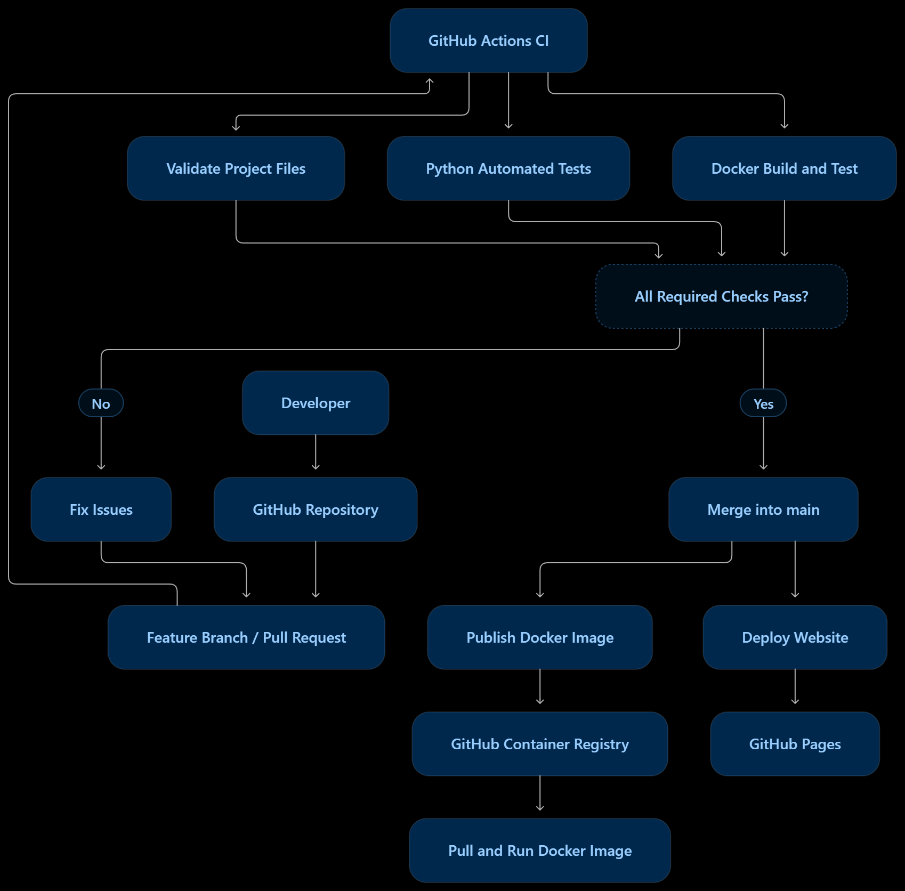

# git-devops-training
Practical Git and GitHub training

## Docker Containerization

This project demonstrates the containerization of a Python calculator application using Docker.

The application is packaged into a Docker image, tested inside a container, and published to GitHub Container Registry (GHCR).

### Docker Image

**Image:** `ghcr.io/felixchatira/bitsec-calculator`

**Available tags:**
- `latest` – latest successfully published image.
- `sha-<commit>` – image associated with a specific Git commit.

### Run the Application

Pull the published image:

```bash
docker pull ghcr.io/felixchatira/bitsec-calculator:latest
```

Run the container:

```bash
docker run --rm ghcr.io/felixchatira/bitsec-calculator:latest
```

### Run Automated Tests Inside Docker

```bash
docker run --rm ghcr.io/felixchatira/bitsec-calculator:latest \
  python -m unittest discover -s tests -v
```

## CI/CD Pipeline

GitHub Actions automates the project's validation, testing, Docker build, image publishing, and website deployment.

### Pipeline Jobs

1. **Validate Project Files** – verifies required documentation.
2. **Python Automated Tests** – executes unit tests.
3. **Docker Build and Test** – builds the Docker image and runs tests inside the container.
4. **Publish Docker Image** – publishes the image to GHCR after successful checks on the main branch.
5. **Deploy Website** – deploys the project website through GitHub Pages.

### Pipeline Triggers

- Pull requests targeting `main` run validation, Python tests, and Docker build and test.
- Pushes to `main` run all checks, publish the Docker image, and deploy the website.

### Container Registry

Published Docker images are available through:

[GitHub Container Registry](https://github.com/FelixChatira?tab=packages)

## Technologies Used

- Python 3.12
- Docker
- Dockerfile
- Git and GitHub
- GitHub Actions
- GitHub Container Registry (GHCR)
- GitHub Pages
- YAML

## Learning Outcomes

Through this project, the following practical DevOps concepts were implemented:

- Source code version control.
- Feature branching and pull request workflows.
- Automated software testing.
- Docker image creation and container execution.
- Automated container testing.
- Container image versioning and publishing.
- Continuous Integration and Continuous Deployment.
- GitHub branch protection and required status checks.



    
